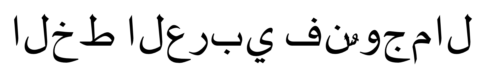
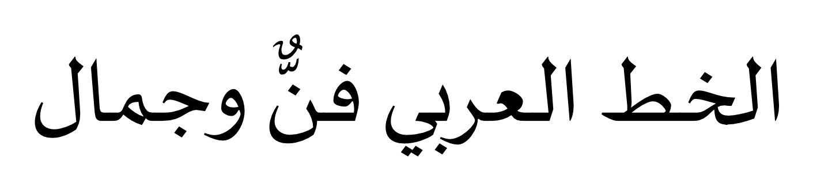
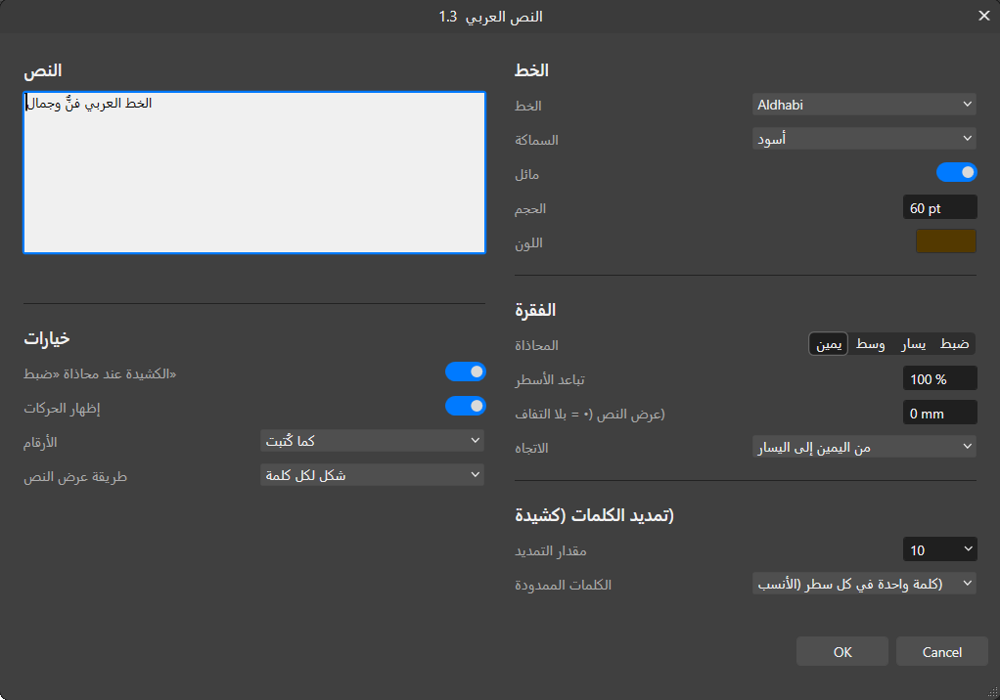
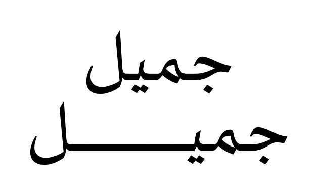
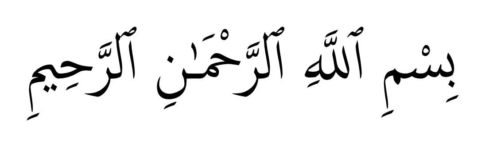
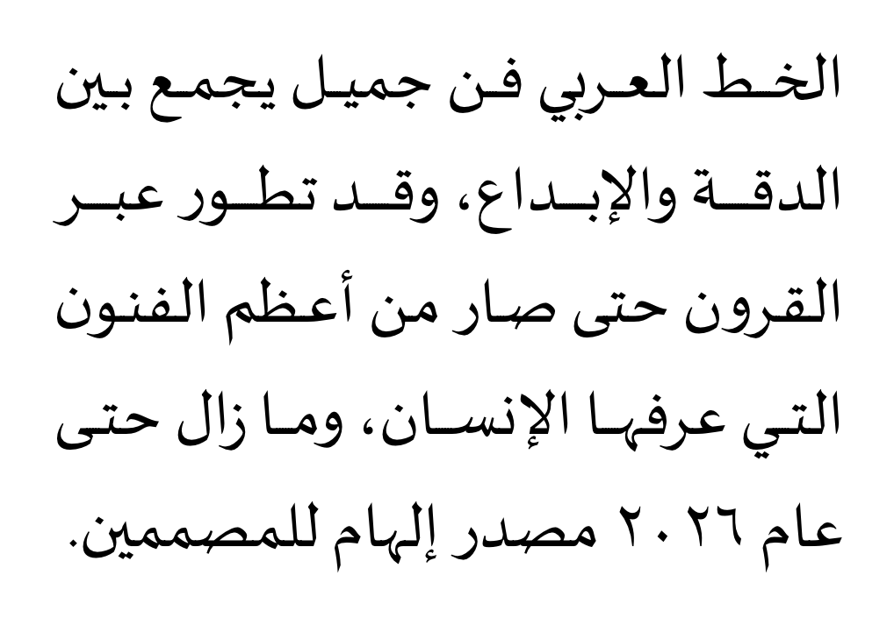
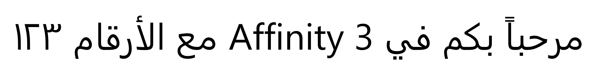

<div dir="rtl">

# النص العربي لـ Affinity — حل مشكلة الكتابة بالعربي في أفينيتي

**أداة مجانية مفتوحة المصدر تجعل Affinity 3 (من Canva) يكتب العربية بشكل صحيح:** حروف متصلة، واتجاه من اليمين لليسار، وحركات في مكانها، وكشيدة، وضبط للفقرات. تعمل داخل البرنامج نفسه، وتحوّل النص إلى أشكال فيكتور حادّة، وتحفظ النص الأصلي داخل الشكل لتعدّله متى شئت.

[⬇️ تحميل آخر إصدار](https://github.com/mahdidigitalx-oss/affinity-arabic-text/releases/latest) · [طريقة التثبيت](#التثبيت) · [الأسئلة الشائعة](#الأسئلة-الشائعة) · [English](#english)

| Affinity وحده ❌ | مع أداة النص العربي ✅ |
|---|---|
|  |  |

## لماذا تظهر العربية مقطّعة ومقلوبة في Affinity؟

محرك النصوص في Affinity Designer وPhoto وPublisher، وفي Affinity 3 الموحّد من Canva، لا يدعم أمرين أساسيين للعربية:

1. **تشكيل الحروف (Shaping):** للحرف العربي حتى أربعة أشكال (منفصل، وأول، ووسط، وآخر). Affinity يعرض الشكل المنفصل دائماً، فتظهر الكلمة حروفاً مقطّعة.
2. **الاتجاه من اليمين لليسار (Bidi):** Affinity يرصّ الحروف من اليسار لليمين، فتظهر الكلمة مقلوبة.

لذلك لا يحلّ المشكلة تغيير الخط ولا لصق النص من برنامج آخر. هذه الأداة تضيف إلى Affinity محرّك التشكيل الحقيقي **HarfBuzz**، وهو نفسه المستخدم في المتصفحات وأندرويد وLibreOffice، وخوارزمية الاتجاه الثنائي الرسمية **Unicode Bidi**.

## المزايا



- **كتابة صحيحة بأي خط عربي مثبّت على جهازك**، مع ربط الحروف و«لا» و«الله» كما صممها الخطاط.
- **معاينة مباشرة على الصفحة** أثناء الكتابة وتغيير الخيارات.
- **الخط والسماكة والمائل، والحجم، واللون.**
- **المحاذاة:** يمين، ووسط، ويسار، وضبط. وتُضبط الفقرة **بالكشيدة أولاً** كما في المطابع العربية، ثم بالمسافات.
- **تباعد الأسطر، وعرض محدد** تلتفّ عنده الأسطر تلقائياً.
- **تمديد الكلمات بالكشيدة:** في كل الكلمات، أو في كلمة واحدة في كل سطر في أنسب موضع، أو في آخر كلمة. لا يُمدّ لفظ الجلالة أبداً.
- **إظهار الحركات أو إخفاؤها**، مع وضعها في مكانها الدقيق.
- **أرقام عربية (١٢٣) أو إنجليزية (123)**، ومزج صحيح للعربية والإنجليزية في السطر نفسه.
- **طريقة عرض النص:** شكل واحد، أو شكل لكل سطر، أو شكل لكل كلمة، أو الحركات في شكل منفصل (لتلوينها بلون مختلف).
- **قابل للتعديل لاحقاً:** حدّد الشكل وشغّل الأداة، فتفتح بنصك وإعداداتك. ويبقى ما أضفته في Affinity من تدرّج أو حد أو ظل أو تأثيرات، ويبقى موضع الشكل وحجمه.
- **لا ثقوب بيضاء** حيث تتداخل الحروف، لأن الأشكال تُملأ بالقاعدة الصحيحة.

| تمديد الكلمات | الحركات | فقرة مضبوطة بالكشيدة |
|---|---|---|
|  |  |  |



## التثبيت

**المتطلبات:** Windows 10 أو 11، و**Affinity 3** (الإصدار المجاني من Canva). جُرّبت الأداة على Affinity 3.3.

1. **حمّل** ملف `ArabicText-for-Affinity-….zip` من [صفحة الإصدارات](https://github.com/mahdidigitalx-oss/affinity-arabic-text/releases/latest)، ثم فكّ ضغطه.
2. **شغّل `install.cmd`** بنقرة مزدوجة. لا يحتاج صلاحيات المدير، وإن ظهر تحذير من Windows فاختر «تشغيل». سيقوم بما يلي:
   - ينسخ الخطوط العربية المثبّتة على جهازك إلى مجلد «خطوط النص العربي» على سطح المكتب، لأن Affinity لا يسمح للأدوات بقراءة مجلد الخطوط في Windows.
   - يضيف مساعداً صغيراً يعمل في الخلفية عند تسجيل الدخول، فيحدّث المجلد كلما ثبّتّ خطاً جديداً.
   - يسمح لـ Affinity بقراءة ذلك المجلد. إن كان Affinity مفتوحاً، فأغلقه مرة واحدة وأعد فتحه.
3. **في Affinity:**
   - من **Settings ← Scripting** تأكد أن البرامج النصية مفعّلة.
   - افتح لوحة **Scripts Library** (من قائمة Window)، واضغط زر القائمة ☰ بجانب مجموعة **Default**، ثم اختر **Import Script…**، ثم اختر ملف `.afscript` الموجود مع الأداة.

ستظهر الأداة في اللوحة باسم **«النص العربي»**.

## الاستخدام

- **نص جديد:** لا تحدد شيئاً، ثم انقر نقراً مزدوجاً على «النص العربي» في لوحة Scripts Library. اكتب نصك واختر الإعدادات، ثم اضغط **OK**.
- **تعديل نص:** حدّد الشكل العربي، ثم شغّل الأداة. تفتح النافذة بالنص والإعدادات السابقة.
- إن لم تتحدث المعاينة أثناء الكتابة، فاضغط **Tab**.

## الأسئلة الشائعة

<details>
<summary><b>هل تعمل مع Affinity Designer 2 أو Photo 2 أو Publisher 2؟</b></summary>

لا. البرامج النصية (Scripting) موجودة في Affinity 3 فقط، وهو الإصدار الموحّد المجاني من Canva.
</details>

<details>
<summary><b>هل يبقى النص قابلاً للتعديل؟</b></summary>

نعم، لكن من الأداة لا من أداة النص في Affinity. النص الأصلي وإعداداته محفوظة داخل الشكل نفسه، حتى بعد حفظ الملف وإعادة فتحه. حدّد الشكل وشغّل الأداة لتعديله.
</details>

<details>
<summary><b>إذا أرسلت الملف لشخص آخر، هل سيراه صحيحاً؟</b></summary>

نعم. النص أشكال فيكتور، فيظهر صحيحاً على أي جهاز، وفي التصدير إلى PDF وSVG وPNG، حتى لو لم يكن الخط مثبّتاً عند الطرف الآخر. ولكي يعدّل النص هو أيضاً، يحتاج الأداة والخط نفسه.
</details>

<details>
<summary><b>ظهرت رسالة «تعذّرت قراءة مجلد الخطوط» أو PERMISSION_DENIED</b></summary>

أغلق Affinity وافتحه من جديد، فالمساعد يعيد الإذن تلقائياً عند الإغلاق. السبب أن Affinity لا يحفظ إعداداته إلا عند إغلاقه بشكل طبيعي، فإن انهار ضاع الإذن. ويمكنك أيضاً إضافة المجلد بنفسك من Settings ← Scripting.
</details>

<details>
<summary><b>ثبّتّ خطاً جديداً ولا يظهر في القائمة</b></summary>

ينتظر المساعد بضع ثوانٍ ثم يحدّث المجلد. إن كنت مستعجلاً فشغّل `sync-fonts.cmd`، ثم أعد فتح الأداة.
</details>

<details>
<summary><b>هل ترسل الأداة أي بيانات إلى الإنترنت؟</b></summary>

لا. كل شيء يعمل على جهازك، والأداة لا تستخدم الشبكة.
</details>

## الإزالة

شغّل `uninstall.cmd`، ثم احذف «النص العربي» من لوحة Scripts Library (زر الفأرة الأيمن ← Delete Script).

## القيود المعروفة

- Windows فقط حالياً.
- مربع الكتابة في النافذة لا يعرض النص بالخط المختار، فهذا قيد في نوافذ Affinity. المعاينة على الصفحة هي التي تعرضه.
- تحريك نقاط الحروف يدوياً يضيع عند تعديل النص بالأداة، لأن الحروف تُرسم من جديد. أما المظهر فيبقى.

</div>

---

<a id="english"></a>

## English — Arabic text support for Affinity 3

**Affinity (Designer, Photo, Publisher, and the unified Affinity 3 by Canva) cannot write Arabic:** letters come out disconnected (no shaping) and in reverse order (no right-to-left/bidi). This free, open-source script fixes that from inside Affinity:

- Real Arabic shaping with **HarfBuzz** (the engine used by browsers and Android) and the **Unicode Bidi** algorithm, compiled to plain JavaScript because Affinity's script engine has no WebAssembly.
- A native-looking dialog with **live preview**: font, weight, italic, size, colour, alignment, **kashida justification**, line spacing, fixed width with wrapping, direction, **word stretching (tatweel)**, harakat on/off, Arabic-Indic or Latin digits, and output as one shape, a shape per line, per word, or harakat as a separate shape.
- Output is **vector curves** that look right everywhere (PDF, SVG, PNG, other machines). The original text and settings are stored inside the object: select it and run the tool again to edit. Fills, strokes, effects and placement you added in Affinity are kept.

**Install:**

1. Download the zip from [Releases](https://github.com/mahdidigitalx-oss/affinity-arabic-text/releases/latest) and run `install.cmd`. No admin rights are needed. It mirrors your Arabic fonts to a Desktop folder Affinity scripts may read, keeps that folder current, and allows it under *Settings › Scripting*.
2. In Affinity, enable scripting, then in the *Scripts Library* panel open the ☰ menu next to the *Default* category, choose *Import Script…*, and pick the `.afscript` file.

Windows only; tested with Affinity 3.3 on Windows 10.

## For developers

```bash
npm install
node tools/build-hb.mjs     # harfbuzzjs WebAssembly -> plain JS (build/hb-asm.cjs)
node tools/build.mjs        # the Scripts Library script -> dist/arabic-text.js
node test/layout.test.cjs   # Node tests (shaping, layout, kashida)
node test/hb-node.test.mjs  # checks the JS HarfBuzz against the official WebAssembly build
```

- `src/`: `hb.js` (HarfBuzz wrapper), `text.js`, `kashida.js`, `layout.js` (line breaking, bidi, justification), `curves.js` (glyphs to Affinity curves), `document.js` (create and replace objects, tags), `engine.js`, `ui.js` (dialog), `main.js`.
- `tools/`: build scripts, the installer, and the font mirror and its watcher (PowerShell).
- `test/*.affinity.js` run inside Affinity through its built-in MCP server: bundle them with `node tools/bundle.mjs <test> build/<name>.js`, then run `node dev/mcp.mjs run build/<name>.js`. `test/showcase.affinity.js` renders the images in `docs/images`.
- Releasing: save `dist/arabic-text.js` to the Scripts Library (`node dev/mcp.mjs save dist/arabic-text.js "النص العربي" "<description>"`), use *Export Script* to get the `.afscript` file, then zip it with `install.cmd`, `uninstall.cmd`, `sync-fonts.cmd` and the PowerShell files in `tools/`.

## License

MIT, see [LICENSE](LICENSE). Bundled third-party code: HarfBuzz (Old MIT), harfbuzzjs (MIT), bidi-js (MIT), listed in [THIRD_PARTY_LICENSES.txt](THIRD_PARTY_LICENSES.txt). No fonts are included; the tool uses the fonts installed on your computer.

<sub>Keywords: Affinity Arabic, Affinity Designer Arabic text, Affinity 3 Arabic support, Affinity RTL, Arabic letters disconnected reversed Affinity, Canva Affinity Arabic fix, kashida, tatweel, harakat · أفينيتي عربي، افينتي، أفينيتي ديزاينر العربية، حل مشكلة الحروف العربية المقطعة في أفينيتي، الكتابة بالعربي في Affinity، النص العربي مقلوب في Affinity</sub>
